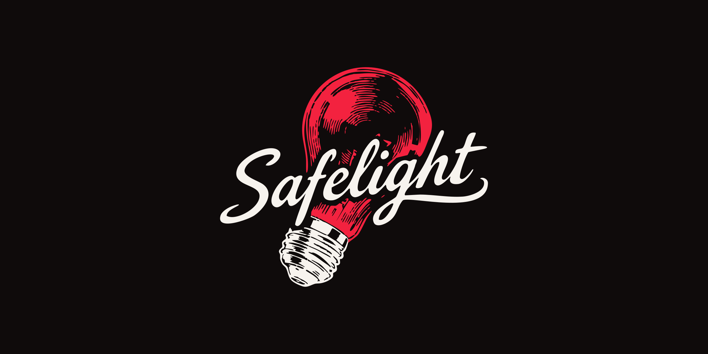

<p align="center">
  
</p>

<h1 align="center">Swap a tool, not your editor</h1>

<p align="center"><strong>A fast, free, open source RAW photo editor for Windows, macOS and Linux, built as a lean core plus real extensions.</strong></p>

## Why Safelight

Most RAW editors, paid or free, try to be everything in one app, and the developer decides what's in the box. Safelight is built the other way round: a lean core that reads your photos and keeps your edits, with every tool on top of it an extension, even the ones it ships with.

When a better tool comes along, you add it to the workflow you already have instead of switching apps and relearning everything. Prefer a different sharpening tool? Swap the extension. The core is the part to judge Safelight on. Tools come and go, and the choice in the open source extension library keeps growing.

It opens ready to edit, with familiar tools and sensible defaults. What it becomes from there is your choice.

- **Yours, forever.** Free and open source under the GPL. No subscription, no account, no expiry. The copy you install today is yours to keep, for good.
- **Private by default.** No accounts, no analytics, no behavioural telemetry. Your photos and edits stay on your machine; the core app never uploads them. It checks GitHub for app and extension updates on launch (turn that off and it goes fully offline), and optional extensions reach the network only where you point them. Exports leave out your camera EXIF, GPS and XMP unless you turn metadata on. See [PRIVACY.md](PRIVACY.md).
- **Lean by choice.** Carry only the tools you actually use; everything else stays out until you want it.
- **Serious about images.** Real, full-resolution RAW and a 16-bit GPU pipeline under the hood. Free was never meant to mean basic.

**Your workspace. Your rules.**


## Why everything is an extension

In Safelight, nothing is load-bearing except the core. Every tool, panel and look is an extension you can keep, move, replace or switch off:

- **Switch off anything.** Never reach for a tool? Switch it off and it's gone: out of the render pipeline, the menus and the interface, not just hidden behind a setting. The program carries only what you use.
- **Add a tool when you need it.** Some jobs come around once a season. Install the tool for the afternoon, then switch it off again. The open source extension library is there when you want it, not loaded all the time.
- **Make it your own.** Don't like a panel? Swap in another one, or build your own. Panels, themes, layouts, display transforms, lens profiles and export processors are all extensions you can install, move or replace.


What you end up with is your own setup: only the tools you want, exactly where you expect them.

## Calling all developers

A lot of us are building great photo tools on our own: a film simulation, a denoiser, a set of scopes, a module ported from another editor over a weekend. Each one ships as its own project with its own app, so using the one tool you like means installing a whole program around it. I got tired of that, so I built Safelight to bring them together.

At its heart, Safelight is an extension manager that gathers everyone's tools and modules into one RAW editor. You keep your own repo, your own licence, and your name on the work. Photographers install it from the open source extension library inside Safelight, right beside everything else they use, instead of adding yet another program to their machine.

And it grows together. Someone who comes for one extension browses the library and finds the rest, so every new user is one more person who might find yours. The bigger the library gets, the more people see what everyone has built.

- **Bring what you've built.** Panels, tools, GPU processing stages, display transforms, export processors, themes, whole modules. Start with [Building Extensions](docs/dev/extensions/README.md).
- **Publish it on GitHub.** Add the `safelight-extension` topic and tag a release, and it shows up in the open source extension library. See [Publishing](docs/dev/extensions/publishing.md).
- **Find something to build.** Propose an extension or claim one from the [roadmap](ROADMAP.md).

## What's inside

Two modules and an open workspace, with defaults that feel familiar from the first photo:


- **Library:** open a folder and edit. Non-destructive and project-based; your originals are never touched, and ratings, flags, keywords, and edit history live in a portable `.safelight/` folder. Fast, keyboard-driven culling, filtering, and sorting.
- **Develop:** white balance, tone, curves, HSL, colour grading, detail, lens corrections, geometry and Upright, local masking, heal/clone, and presets, all rendered through a WebGL2 pipeline running in a Web Worker.
- **Export:** batch JPEG, PNG, WebP, and 8/16-bit TIFF through the same pipeline, with proper output colour spaces and embedded ICC profiles. Camera EXIF is left out unless you turn on **Include metadata**, GPS needs its own switch, and XMP is never copied.
- **Workspace:** dockable panels (drag, tab, float or minimize any of them), named layouts, themes, rebindable shortcuts, and detachable modules for multi-monitor work.

Real RAW support spans NEF, CR2/CR3, ARW, DNG, ORF, RAF, RW2 and many more, via libraw-wasm plus an in-house linear-float decoder, with automatic fallback to the embedded preview.

**→ See the full [User Guide](docs/user/user-guide.md) for every feature in detail.**

## Install

Download the latest build for your platform from the [releases page](../../releases):

- **Windows:** `Safelight Setup` installer (recommended; fastest RAW decode and full GPU acceleration)
- **macOS:** universal `.dmg` (Intel + Apple Silicon)
- **Linux:** `.deb`, `.rpm`, `.pacman`, Flatpak, or portable AppImage

Or build from source:

```bash
git clone https://github.com/anthonyreimche/SafeLight.git
cd SafeLight
npm install
npm run dev          # development build in a Chromium-based browser
npm run electron:dev # desktop window
```

See [Installation](docs/user/installation.md) for platform notes and full build instructions.

## Documentation

Full docs live in [`docs/`](docs/README.md), split into two tracks:

**📖 [User Guide](docs/user/README.md)**: using Safelight
- [Getting Started](docs/user/getting-started.md) · [Installation](docs/user/installation.md) · [User Guide](docs/user/user-guide.md) · [Using Extensions](docs/user/using-extensions.md) · [Extension safety & terms](EXTENSIONS.md) · [FAQ](docs/user/faq.md) · [Changelog](docs/user/changelog.md)

**🛠 [Developer Docs](docs/dev/README.md)**: building for Safelight
- [Architecture](docs/dev/architecture.md) · [Building Extensions](docs/dev/extensions/README.md) · [API Reference](docs/dev/api/README.md) · [Contributing](docs/dev/contributing.md)

## Roadmap

Safelight is under active development. The **[Safelight project board](https://github.com/users/anthonyreimche/projects/4)** is the live roadmap, tracking planned and in-progress work for the core app and for optional extensions. See [ROADMAP.md](ROADMAP.md) for how work gets on the board and how to propose or claim an extension.

## Contributing

Safelight is community-driven. Bug reports, code, extensions, documentation, and feedback are all welcome. See [Contributing](docs/dev/contributing.md). Contributions use the standard inbound = outbound model: you license your contribution under the project's GPL v3 and keep your copyright. There's no separate agreement to sign.

## Licence

Safelight is free software under the [GNU GPL v3](LICENSE), with a Section 7(b) attribution-preservation term (see [NOTICE](NOTICE)). There is no paid, "pro", or proprietary edition. It bundles third-party components under their own licences ([THIRD-PARTY-NOTICES](THIRD-PARTY-NOTICES.md)), and third-party product names are trademarks of their respective owners ([TRADEMARKS](TRADEMARKS.md)). See [LICENSING.md](LICENSING.md) for the full picture.
