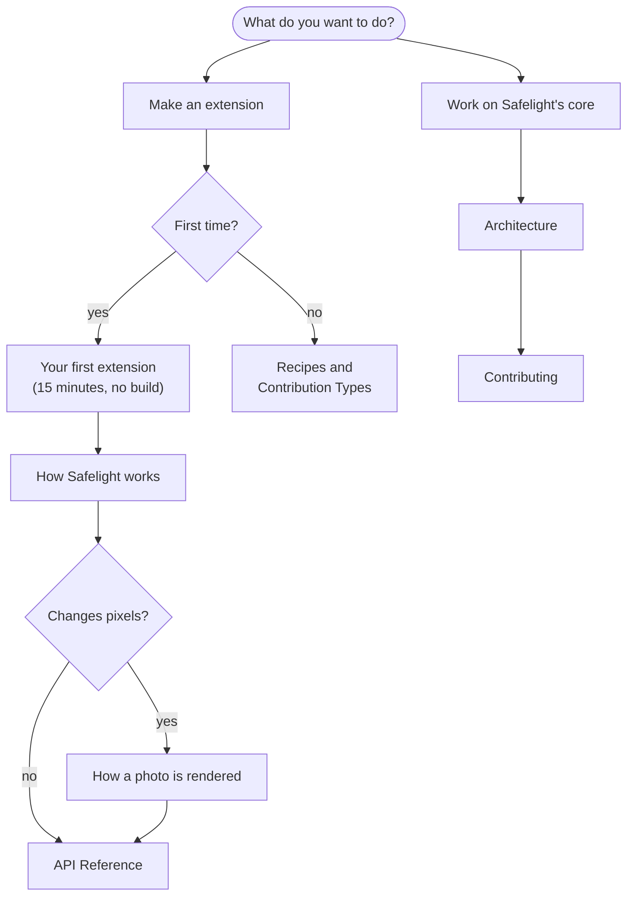

# Developer Docs

For people building extensions and people working on Safelight itself.

## Pick a path

- **Never made a Safelight extension?** Start with [Your first extension](extensions/first-extension.md). It builds a working panel and GPU stage from two files, with no GitHub, npm or build step, and shows the edit-reload loop.
- **Know what you want to build?** [Recipes](extensions/recipes.md) has complete examples (Library menu items, export stamps, sidecars, LUTs, themes), and [How Safelight works](concepts.md#where-to-find-everything) maps goals to the right API and a real extension that uses it.
- **Changing pixels?** Read [How a photo is rendered](rendering.md) before you pick a phase.
- **Unfamiliar word?** See the [Glossary](glossary.md).

## Building extensions

- [Your first extension](extensions/first-extension.md): a panel, sliders, presets and a stage, step by step
- [Recipes](extensions/recipes.md): short complete examples for common jobs
- [Building Extensions](extensions/README.md): repo layout, the manifest, adding a build step, the store listing
- [Contribution Types](extensions/contribution-types.md): every `register*` call, one line each
- [Debugging](extensions/debugging.md): Developer Tools, the dev folder, load and GLSL errors
- [Publishing](extensions/publishing.md): store page, releases and versions
- [How Safelight works](concepts.md): what the core does, how extensions are loaded, what they can access
- [How a photo is rendered](rendering.md): the processing order, phases, the param bag, colour management

## API reference

- [API Overview](api/README.md): the `SafelightAPI` object and its controls
- [UI Shell](api/ui-shell.md): modules, panels, per-mask panels, header accessories, slots, layouts
- [UI Components](api/components.md): `api.components`, `api.ui`, theming tokens, styling hooks
- [Contribution Types](api/contributions.md): the full fields of every `register*` call
- [State Stores & Data APIs](api/stores.md): `api.stores`, `api.develop`, `api.catalog`, `api.export`, `api.params`, `api.variables`
- [Core Data Types](api/types.md): `CatalogPhoto`, `DevelopParams`, masks, `EditState`
- [Subsystems](api/subsystems.md): storage, rendering, RAW, presets, export, keybindings, the Electron bridge

The pages summarize the TypeScript definitions in [`src/extensions/api/`](../../src/extensions/api/), which are the exact reference. `contributions.ts` holds every `register*` shape and `scoped-api.ts` the `api` object itself. Every published extension in the store is open source too, and most are short enough to read in one sitting.

## Working on the core

- [Architecture](architecture.md): the orchestrator model, render path, RAW pipeline, Electron shell
- [Contributing](contributing.md): setup, tests, code style, where things live
