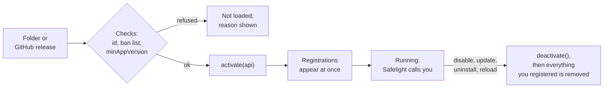
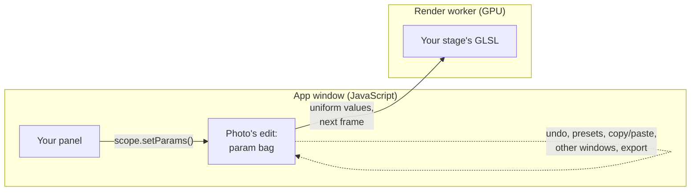

# How Safelight works

This page covers the ideas behind Safelight's extension system: what the core does, how it loads and runs extensions, what an extension can read and change, and where to find the API for each kind of tool. The reference pages assume you've read it.

## The core and the registry

Safelight is split into a core and extensions. The core handles the work that can only happen in one place:

- opening projects and keeping the catalogue
- decoding RAW files
- rendering photos on the GPU
- edit history, presets and copy and paste of settings
- export
- the app window, the dock, and the extension manager

What appears inside the window is mostly up to extensions. Panels, modules, themes, layouts, display transforms, GPU processing stages, keyboard shortcuts and export processors are all registered by extensions into a shared registry, and the core builds the interface from whatever the registry holds. When Develop lays out its side panels, it asks the registry which panels want to be there. When the renderer builds the shader for a photo, it compiles in every processing stage that's registered. The core doesn't keep its own list of tools, so it makes no difference to it which extension a panel or stage came from.

The tools that ship with Safelight work the same way. Library, Develop, Basic, White Balance, Tone Curve, HSL, Crop, Masking and the other stock tools are the **Essentials**, a set of extensions installed on first launch. They register through the same API yours will use, so they can be updated, rolled back to an earlier release or switched off under **Extensions ▸ Installed**, and you can replace any of them. Their processing stages run at fixed points in the shader, and yours slot in between them by phase. [How a photo is rendered](rendering.md) walks through that order.

The one extension that can't be switched off is **Safelight Core**. It registers the extension manager, the stock themes, the Classic layout, the built-in display transform and the denoiser. If you register your own noise-reduction stage, it takes the denoiser's place.

### An extension describes, Safelight places

If you've written a plugin for a code editor, the shape will be familiar: a manifest, an entry module with an `activate` function that registers what the extension adds, and a user who can disable or remove anything.

An extension describes what it adds and Safelight decides how to fit it in. A panel asks to sit on the right side of Develop, and the dock puts it there, remembers where the user drags it, and saves it in their layouts. A stage asks for a phase, and the renderer places it in the shader. You don't manage the window or the pipeline yourself.

## How an extension is loaded

An extension is a folder with a `safelight.json` manifest and a ready-to-run JavaScript module. Published extensions are GitHub repos: users install them from the store, which downloads them into Safelight's plugins folder. While you're developing, the Developer Tools extension can load extensions straight from a folder on your disk instead (desktop app only), so you don't need GitHub until you publish. See [Your first extension](extensions/first-extension.md) for the folder layout and [Debugging](extensions/debugging.md) for the dev folder.

From there, an extension goes through these steps:

1. **Checks.** Safelight refuses the extension if:
   - its id is `core` or starts with `core.` (reserved for built-ins)
   - it's on the trust registry's ban list (a running extension that gets banned is stopped)
   - it needs a newer Safelight than the user has, according to `minAppVersion` (refused before any files are written)
2. **Activation.** Safelight imports your module and calls its `activate(api)` export. The `api` object is scoped to your extension, so everything you register through it is tagged with your extension's id.
3. **Registration.** Registrations take effect straight away. A new panel shows up in the dock, a new stage makes the renderer rebuild the shader, and a new theme appears in the theme picker.
4. **Running.** Safelight calls into your code when it needs to: rendering your panel, running your GLSL every frame, or calling your catalogue hooks when photos are imported or edited.
5. **Stopping.** When the user disables, updates or uninstalls the extension, Safelight calls your `deactivate()` export if you have one, then removes everything tagged with your id. You don't need to unregister anything yourself.

A few related behaviours:

- Your settings are kept when the extension is disabled and deleted when it's uninstalled.
- Updates install the new version next to the old one first, and roll back if the new version fails to start.
- Each Safelight window runs its own copy of every extension. Popping out a panel or a module opens a new window, and your `activate` runs again there. If windows need to agree on something, keep it in `api.settings` (saved between sessions) or `api.variables` (shared for the session) instead of a module-level variable.

## What an extension works with

Everything an extension uses comes from the `api` object passed to `activate`:

- **UI building blocks.** `api.react` is the app's own React instance. Use it instead of bundling React, because a second copy breaks hooks. Safelight's components and controls are in `api.components` and `api.ui`, and they already follow the user's theme.
- **App state.** `api.stores` exposes the same Zustand stores the interface uses: the catalogue, the photo open in Develop and its edit, UI state, settings, presets and layouts. You can read them, subscribe to them and write to them.
- **Helpers for common jobs.** `api.catalog` covers photo records and edit histories, `api.develop` covers the Develop canvas and rendering frames of a photo, and `api.export` renders finished images without writing files.
- **Events.** Catalogue hooks fire when a photo is imported, its metadata changes, an edit is committed or a photo is removed. You can also watch your settings with `api.settings.onChange` and shared variables with `api.variables.subscribe`.

What you give back is mostly registrations. Every `register*` call adds a piece to the app, such as a panel, a stage, a theme, a shortcut or a menu item, and [Contribution Types](extensions/contribution-types.md) lists them all. Beyond that you can write edits and catalogue data, save your own settings, publish values for other extensions through `api.variables`, and drive the app with `api.navigation`, `api.dock`, `api.themes` and the other controls in the [API overview](api/README.md#imperative-control-surfaces).

### Panels and stages

An editing extension usually has two parts that run in different places. The panel and its logic are JavaScript running in the app window. The processing stage is GLSL that runs on the GPU, inside the shader, in a separate render worker. The two never call each other. Instead, the panel writes values into the photo's edit, and the renderer passes those values to the stage's uniforms the next time it draws.

[Your first extension](extensions/first-extension.md) builds exactly this, with three sliders.

Safelight keeps these values in the photo's param bag, a set of extension values stored next to the regular develop settings and keyed `"{stageId}.{key}"`. Since they're part of the edit, they work with undo, presets, copy and paste, other windows and export exactly like the built-in sliders do. [How a photo is rendered](rendering.md#per-photo-settings-the-param-bag) goes into more detail.

## What an extension can access

Extensions run in the same JavaScript context as Safelight's own interface. The scoped `api` keeps track of what you registered, but it isn't a sandbox.

- **App data.** An extension can read or change anything the interface can, including the catalogue, edits, settings and the window's DOM. For the DOM, stick to the dock, slots and stylesheets, because core markup changes between releases.
- **Files.** There's no raw filesystem access by path. Safelight claims the file and update bridges for itself before any extension loads. Extensions work with the file handles they're given, such as the folder handle passed to the import and removal hooks.
- **Network.** `fetch` and XHR reach only the HTTPS origins you list under `permissions.network` in your manifest, plus Cloudflare Worker hosts (`*.workers.dev`), which every extension may reach. Declared origins join the app's content-security policy at the next launch. Images load from any HTTPS host. Declare every host you use: it's what users see on your store page.
- **GPU.** Your GLSL runs on every photo while your extension is enabled.
- **Other extensions.** Anything in `api.variables` can be read by every other extension, so don't store secrets there.

Users decide which extensions to trust. The [trust registry](https://github.com/anthonyreimche/safelight-registry) marks extensions a maintainer has reviewed as verified and can ban malicious ones, and users can limit the store to verified extensions. The full safety model is described in [EXTENSIONS.md](../../EXTENSIONS.md).

## Where to find everything

The published extensions are the best examples of each API in real use.

| To... | Use | Reference | Example |
|---|---|---|---|
| Get something on screen in 15 minutes | `safelight.json`, `activate(api)` | [Your first extension](extensions/first-extension.md) | [Slate Theme](https://github.com/anthonyreimche/Slate-Theme) (three files) |
| Set up a repo with a build step | Vite, rolldown or esbuild | [Building Extensions](extensions/README.md) | [Colour Correction](https://github.com/anthonyreimche/Colour-Correction) |
| Add a panel | `registerPanel` | [UI Shell](api/ui-shell.md#panels-registerpanel) | [Colour Correction](https://github.com/anthonyreimche/Colour-Correction) |
| Add a whole module beside Library and Develop | `registerModule` | [UI Shell](api/ui-shell.md#modules) | [Map](https://github.com/anthonyreimche/Map) |
| Change pixels per pixel | `registerProcessingStage` | [Rendering](rendering.md), [Contributions](api/contributions.md#processingstagecontribution--gpu-stage) | [Colour Correction](https://github.com/anthonyreimche/Colour-Correction) |
| Blur, sharpen, denoise (neighbouring pixels) | a stage with `passes` | [Contributions](api/contributions.md#processingstagecontribution--gpu-stage) | [Glow](https://github.com/anthonyreimche/Glow) |
| Warp the image | a `geometry` stage | [Rendering](rendering.md#which-hook-do-i-want) | [Image Warp](https://github.com/anthonyreimche/Image-Warp), [Lens Correction](https://github.com/anthonyreimche/Lens-Correction) |
| Replace the tone mapper or colour rendering | `registerPipeline` | [Rendering](rendering.md#colour-management-what-you-can-and-cant-change) | [Advanced Rendering](https://github.com/anthonyreimche/Advanced-Rendering) |
| Edit inside masks | `mask` on the stage and panel, `api.develop.useParamScope` | [UI Shell](api/ui-shell.md#per-mask-panels-panelcontributionmask) | [Colour Correction](https://github.com/anthonyreimche/Colour-Correction) |
| Draw on the Develop canvas | `registerSlot` in `develop-canvas-overlay` | [UI Shell](api/ui-shell.md) | [Image Comparison Tools](https://github.com/anthonyreimche/Image-Comparison-Tools) |
| Read and write sidecars or metadata | `registerCatalogHooks` | [Recipes](extensions/recipes.md#a-sidecar-file-next-to-each-photo), [Contributions](api/contributions.md#cataloghookscontribution) | [XMP Tools](https://github.com/anthonyreimche/XMP-Tools) |
| Add to the Library menu, sorts or filters | `registerGridMenuItem`, `registerLibrarySort`, `registerGridFilter` | [Contributions](api/contributions.md) | [Virtual Copies](https://github.com/anthonyreimche/Virtual-Copies), [Advanced Library Sort](https://github.com/anthonyreimche/Advanced-Library-Sort) |
| Import other apps' presets | `registerPresetImporter` | [Contributions](api/contributions.md#presetimportercontribution) | [3rd-Party Preset Tools](https://github.com/anthonyreimche/3rd-Party-Preset-Tools) |
| Render photos without opening them | `api.export.renderPhotos`, `api.develop.renderPhotoFrame` | [Stores](api/stores.md#apiexport) | [Batch Tools](https://github.com/anthonyreimche/Batch-Tools) |
| Change the exported file | `registerExportProcessor` | [Recipes](extensions/recipes.md#copyright-stamp-on-export), [Contributions](api/contributions.md#exportprocessorcontribution) | |
| Share state with other extensions | `api.variables` | [Stores](api/stores.md#apivariables-shared-variables) | [GPS Track](https://github.com/anthonyreimche/GPS-Track) and [Map](https://github.com/anthonyreimche/Map) |
| Restyle the app | `registerTheme`, `registerStylesheet` | [UI Components](api/components.md#styling-hooks) | [Custom Input Styling](https://github.com/anthonyreimche/Custom-Input-Styling) |
| Decorate every panel header | `registerPanelHeaderAccessory` | [UI Shell](api/ui-shell.md) | [Panel Toggle](https://github.com/anthonyreimche/Panel-Toggle) |
| Debug, live-reload, inspect the pipeline | Developer Tools | [Debugging](extensions/debugging.md) | |
| List it in the store | GitHub topics, releases | [Publishing](extensions/publishing.md) | |

The exact types for everything here are in [`src/extensions/api/`](../../src/extensions/api/), mainly `contributions.ts` and `scoped-api.ts`. The reference pages summarize them.
