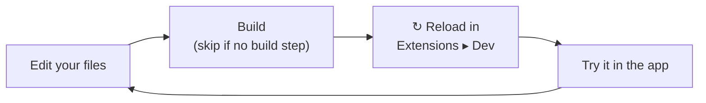

# Developing & Debugging

← [Building Extensions](README.md)

**Developer Tools** is an official extension from the store. It adds an inspector panel, console and error capture, and the dev folder, which loads extensions from your disk while you work on them. Without it installed and switched on, none of that runs, so a normal user's app stays untouched.

## Install it

1. Open the Extensions window (the puzzle button in the top bar, or **Ctrl+Shift+X**).
2. In **Browse**, find **Developer Tools** and install it. Under **Installed**, check it's switched on.
3. Open its panel from **View ▸ Developer Tools** or with **Ctrl+Alt+I**. It docks like any panel and can be popped out into its own window (the ⧉ button).

Until Safelight 3.2.0 it was built in. If you're on an older version, switch it on under **Installed** instead.

<!-- Screenshot: Developer Tools panel, Pipeline tab, own stage highlighted. See docs/dev/images/README.md -->

The panel has seven tabs:

- **Console**: captured `console.*` output with level filters, search and an inline **REPL** (`window.safelight` is the extension API). The desktop app's content-security policy refuses `eval`, so there the REPL doesn't run: use the **Native** tab to open Chrome DevTools instead.
- **Issues**: warnings and errors only, with a count badge.
- **System**: app and runtime versions, platform, cross-origin isolation (affects RAW decode), WebGL vendor and limits, JS heap, and (desktop) GPU feature status.
- **Storage**: a `localStorage` browser and editor (Safelight keys are `sl_*`).
- **Variables**: every shared variable (`api.variables`) with its writers, subscribers, value and recent history, and an editor for its value.
- **Pipeline**: the develop program the open photo renders with. It lists Safelight's blocks in order, each stage between them (owner, phase, priority, space, whether it reads the current image, its copies inside masks), the conversions between spaces, and every point where the colour is clipped to [0, 1]. The v1/v2/v3 picker shows what another process version runs. With no photo open, or in a popped-out window, it shows default settings. Its "found in GLSL" lines come from a text scan of your inline GLSL and helpers, so they can miss clamps or report false ones.
- **Native** (desktop only): open, dock or toggle Chrome DevTools, soft or hard reload, and per-process CPU and memory.

## Live-load from a folder (the iterate loop)

Reinstalling from GitHub on every change is slow. Instead, point Safelight at a **local folder of built extensions** and it loads them live. **Desktop app only**, since it reads bundles over the native filesystem bridge.



1. **Extensions ▸ Dev** (or **Preferences ▸ Developer Tools**) ▸ **Choose folder…**. The Dev section only appears while Developer Tools is switched on.
2. Each immediate subfolder is one extension, in the same `safelight.json` + built-bundle layout an installed extension uses:
   ```
   my-dev-folder/
   ├─ theme-slate/        →  safelight.json + index.js
   └─ my-extension/       →  safelight.json + dist/index.js
   ```
3. Rebuild your extension, then hit **↻ Reload** on its row (or **Rescan** for the whole folder). The old instance is deactivated and swept before the new one activates. No app restart.

The Dev tab shows each extension's load status, with any error inline. The folder path is stored in Developer Tools' own settings, so disabling Developer Tools unloads every dev extension and forgets the path.

Network access works as for an installed extension: `permissions.network` origins are read when Safelight starts, so choosing a folder or adding a declaration needs one restart. Until then those requests fail (a failed fetch, blank map tiles). The Dev tab lists the origins waiting on a restart.

## When your stage doesn't show

- **A GLSL error.** The stage is left out of the image, and its row in the Extensions window says `Stage "…" failed to compile and is off` with the first line of the compiler's message. The rest of the photo still renders. Fix the code and reload.
- **It compiles but does nothing.** Open the **Pipeline** tab and check your stage is listed in the phase you expect. Then check the values: a panel that writes a key the stage doesn't declare (a typo in `"{stage id}.{key}"`) changes nothing. The **Console** tab shows `console.log` from your code.
- **It changes photos it shouldn't.** Every installed stage runs on every photo. At its default values it must leave the image exactly as it was, so wrap your maths in an `if` on the uniforms.
- **It looks different on some photos.** Check the photo's process version (see [Process versions](../rendering.md#process-versions)). The Pipeline tab's v1/v2/v3 picker shows what each version runs.
- **Preview and export differ.** Stages with passes draw at the preview size in Develop and at the export size on export. See [Passes: sizes, formats and cost](../api/contributions.md#passes-sizes-formats-and-cost).

## Common load errors

- **`safelight.json is missing 'id' or 'main'`**: both are required, and `id` must be text. Check the manifest path and that the JSON is valid.
- **`<id>: extension ids under 'core' are reserved for Safelight`**: pick your own id, such as `com.example.name` (see [Manifest](README.md#manifest)). Installing such an extension from GitHub fails too, with only `Invalid safelight.json`.
- **`bundle has no activate(api) export`**: your bundle must `export function activate(api)`. Check that `main` points at the built file and that your bundler outputs an ES module, not CommonJS or an IIFE.
- **`Failed to resolve module specifier "react"`** (or `"react/jsx-runtime"`): the bundle still imports something at runtime. Compile JSX to `React.createElement` with React taken from `api.react`. See [With a build](README.md#with-a-build).
- **Blank or unstyled UI**: Tailwind classes aren't compiled for runtime bundles. Use theme CSS variables with inline styles, or `api.components`. See [Theming tokens](../api/components.md#theming-tokens).
- **`Invalid hook call`**: the bundle contains its own copy of React. Use `api.react` everywhere and keep `react` and `react-dom` external.
