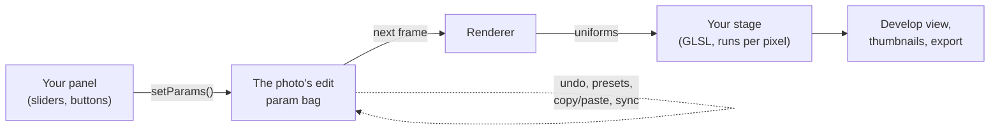
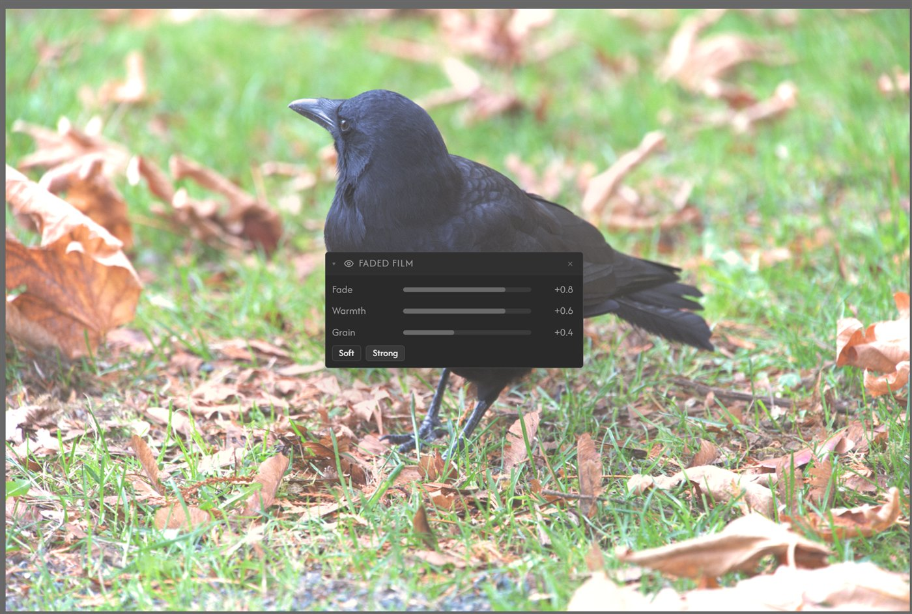

# Your first extension

This walk-through builds a small but complete editing tool: a **Faded Film** panel with three sliders (Fade, Warmth, Grain) and two preset buttons, plus the GPU code that changes the photo. It takes about fifteen minutes.

If your idea doesn't change pixels (a menu item, an export step, a panel that shows information), you can skip the GPU half: [Recipes](recipes.md) has those, and the setup in steps 1, 2 and 4 is the same.

You need the Safelight desktop app and a text editor. You don't need GitHub, npm, a bundler or a copy of Safelight's source. Everything here is plain JavaScript in two files.

← [Building Extensions](README.md) · Next: [Debugging](debugging.md) · Words you don't know: [Glossary](../glossary.md)

## How the pieces fit

An editing extension has two halves that never call each other directly. The panel runs in the app window and writes slider values into the photo's edit. The renderer reads those values and hands them to your GPU code, which runs once for every pixel.



Because the values live in the edit, undo, history, presets, copy and paste and export all work without any extra code.

## 1. Turn on the developer loop

Safelight can load extensions straight from a folder on your disk, so you can edit, reload and see the result without publishing anything.

1. Open the Extensions window (the puzzle button in the top bar, or **Ctrl+Shift+X**).
2. In **Browse**, find **Developer Tools** and install it. Make sure it's switched on under **Installed**.
3. A **Dev** section now appears in the Extensions window. Click **Choose folder…** and pick a folder for your extensions, for example `Documents/safelight-dev`.


You can pick one extension's own folder, or a parent folder where each subfolder is one extension. The parent is handier once you have several. You'll create one called `faded-film`:

```
safelight-dev/
└─ faded-film/
   ├─ safelight.json
   └─ index.js
```

## 2. The manifest

`safelight.json` tells Safelight what the extension is called and which file to load.

```json
{
  "id": "com.example.faded-film",
  "name": "Faded Film",
  "version": "0.1.0",
  "description": "Lifted blacks, a warm tint and grain.",
  "main": "index.js",
  "minAppVersion": "3.2.0"
}
```

Replace `com.example` with something that's yours, such as your GitHub name. The id must be unique across all extensions, so a reversed domain or `yourname.toolname` works well.

## 3. The code

`index.js` exports one function, `activate(api)`. Safelight calls it once when the extension starts, and `api` is your way into the app.

```js
const STAGE = "com.example.faded-film.stage";
const key = (name) => `${STAGE}.${name}`;

const PRESETS = {
  Soft: { fade: 0.4, warmth: 0.3, grain: 0.15 },
  Strong: { fade: 0.8, warmth: 0.6, grain: 0.4 },
};

export function activate(api) {
  // 1. The GPU part: a processing stage.
  api.registerProcessingStage({
    id: STAGE,
    name: "Faded Film",
    phase: "display-adjust",
    space: { encoding: "perceptual" },
    uniforms: [
      { key: "fade", glslType: "float", default: 0, range: { min: 0, max: 1 } },
      { key: "warmth", glslType: "float", default: 0, range: { min: -1, max: 1 } },
      { key: "grain", glslType: "float", default: 0, range: { min: 0, max: 1 } },
    ],
    helpers: `
      float filmHash(vec2 p) {
        vec3 p3 = fract(vec3(p.xyx) * 0.1031);
        p3 += dot(p3, p3.yzx + 33.33);
        return fract((p3.x + p3.y) * p3.z);
      }`,
    glsl: `
      if (fade > 0.0 || warmth != 0.0 || grain > 0.0) {
        c += fade * 0.25 * max(1.0 - c, 0.0);
        c *= vec3(1.0 + 0.08 * warmth, 1.0, 1.0 - 0.08 * warmth);
        c += grain * 0.08 * (filmHash(floor(vUv * 2400.0)) - 0.5);
      }`,
  });

  // 2. The UI part: a panel in Develop.
  const h = api.react.createElement;
  const { Slider } = api.components;
  const { Button, Row, Stack } = api.ui;

  function FadedFilmPanel() {
    const scope = api.develop.useParamScope();
    const value = (name) => Number(scope.getParam(key(name)));
    const slider = (name, label, min) =>
      h(Slider, {
        label,
        min,
        max: 1,
        step: 0.01,
        defaultValue: 0,
        value: value(name),
        onChange: (v) => scope.setParams({ [key(name)]: v }),
        onCommit: () => scope.commit(`Faded Film: ${label}`),
      });
    const preset = (label) =>
      h(Button, {
        size: "sm",
        onClick: () => {
          const p = PRESETS[label];
          scope.setParams({ [key("fade")]: p.fade, [key("warmth")]: p.warmth, [key("grain")]: p.grain });
          scope.commit(`Faded Film: ${label}`);
        },
      }, label);

    return h(Stack, { gap: 6, style: { padding: 8 } },
      slider("fade", "Fade", 0),
      slider("warmth", "Warmth", -1),
      slider("grain", "Grain", 0),
      h(Row, { gap: 6 }, preset("Soft"), preset("Strong")),
    );
  }

  api.registerPanel({
    id: "com.example.faded-film.panel",
    title: "Faded Film",
    component: FadedFilmPanel,
    defaultDock: { module: "develop", direction: "right" },
  });
}
```

What each part does:

- **`registerProcessingStage`** adds GLSL to the program that draws every photo. The `phase` decides where in the processing order it runs (see [How a photo is rendered](../rendering.md)). In `display-adjust` the colour is a variable called `c`, already in screen values from 0 to 1.
- **`uniforms`** are the stage's inputs. In the GLSL you use them by their `key` (`fade`, `warmth`, `grain`). Each photo stores its own values under `"{stage id}.{key}"`, which is what the `key()` helper builds.
- **The `if` block** makes sure that a photo at the defaults is left exactly as it was. Every installed stage runs on every photo, so this matters: without it, installing your extension would change photos people had already finished.
- **`space: { encoding: "perceptual" }`** keeps values above 1.0 intact for the tools after yours. Without a `space`, a display-phase stage clips the image to 0..1 even when it does nothing.
- **`vUv`** is the pixel's position in the frame, from 0 to 1. `filmHash` turns it into a repeatable random number, which is the grain.
- **`api.develop.useParamScope()`** gives the panel the values it edits. `setParams` changes them while a slider moves, and `commit` makes one undo step when the drag ends.
- **`api.react.createElement`** builds the UI without JSX, so there's nothing to compile. Always use `api.react` and never your own copy of React.

## 4. Load it and try it

1. Back in the Extensions window's **Dev** section, click **↻ Rescan**. Faded Film appears with its load status.
2. Open a photo in Develop. The **Faded Film** panel is on the right.
3. Move the sliders, try the preset buttons, then press **Ctrl+Z** to see the undo steps.

When you change `index.js`, save it and click **↻ Reload** on the extension's row. The old copy stops, its panel and stage are removed, and the new one starts. You don't need to restart the app.



The panel may first appear floating, as here. Drag it by its header into a side rail to dock it. If you don't see it at all, your layout may not add new panels by itself: turn it on from the **View** menu.

If it doesn't load, the Dev section shows the error on the extension's row. A GLSL mistake is reported in the Developer Tools console, and the stage is left out of the image until it compiles. [Debugging](debugging.md#common-load-errors) lists the usual causes.

## Where to go next

- **Publish it.** Put the two files in a GitHub repo, add the `safelight-extension` topic, and it shows up in the store. See [Publishing](publishing.md).
- **Use TypeScript, JSX or npm packages.** Start from the [extension template](https://github.com/anthonyreimche/Extension-Template). It builds this same kind of extension, a slider and a stage, with the build, tests and a release workflow set up. [Building Extensions](README.md#with-a-build) explains each part.
- **Get the API's types.** Copy [`extension-types/safelight.d.ts`](../../../extension-types/safelight.d.ts) next to `index.js`. Put `// @ts-check` at the top of `index.js` and `/** @param {import("./safelight").SafelightAPI} api */` above `activate`, and editors such as VS Code complete and check your calls. See [Types](README.md#types).
- **Offer it inside masks.** Add `mask: { maskable: true }` to the stage and a `mask` entry to the panel. See [Per-mask panels](../api/ui-shell.md#per-mask-panels-panelcontributionmask).
- **Other kinds of extension.** Themes, Library menu items, export steps, sidecar files and more are covered in [Recipes](recipes.md) and [Contribution Types](contribution-types.md).
