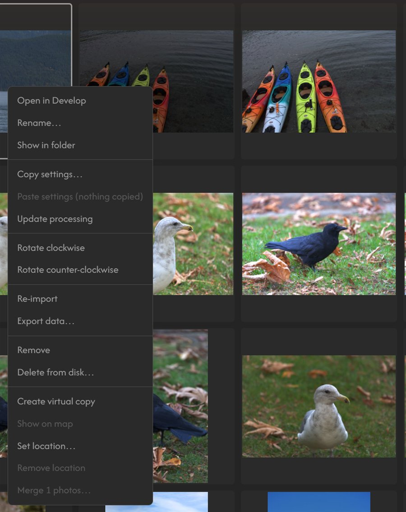

# Recipes

Short examples for the jobs people ask about most. Most work as the whole `index.js` of a no-build extension (see [Your first extension](first-extension.md) for the folder layout and the reload loop); the sidecar and LUT recipes leave parts to you, and say which. Swap `com.example` for your own id.

← [Building Extensions](README.md)

| Recipe | Uses |
|---|---|
| [A Library right-click item that adds a keyword](#library-menu-item-that-adds-a-keyword) | `registerGridMenuItem`, `useCatalogStore` |
| [A copyright stamp on export](#copyright-stamp-on-export) | `registerExportProcessor` with `processPixels` |
| [A sidecar file next to each photo](#a-sidecar-file-next-to-each-photo) | `registerCatalogHooks` |
| [A 3D LUT](#a-3d-lut) | a stage with a `lut` texture, `setStageTexture` |
| [A theme](#a-theme) | `registerTheme` |
| [Export the selected photos to a folder](#export-the-selected-photos-to-a-folder) | `project.pickDirectory`, `export.exportPhotos` |
| [Draw over the photo: a before/after split](#draw-over-the-photo-a-beforeafter-split) | `develop-canvas-overlay` slot, `captureFrame`, `registerKeybinding` |
| [A button that reads the image and changes the edit](#a-button-that-reads-the-image-and-changes-the-edit) | `readDevelopedPixels`, `setParam`, `commitEdit` |
| [Show a value about the photo](#show-a-value-about-the-photo) | `readSourceSample`, `useEffect` |
| [A module of your own](#a-module-of-your-own) | `registerModule`, thumbnails, `goTo` |
| [A slider that changes the photo](first-extension.md) | a stage, a panel and `useParamScope` |

Not every extension needs GLSL. Only a stage changes pixels in the render. Menu items, export steps, overlays and buttons that write the edit are plain JavaScript.

Things most recipes reach for:

| You need | Use |
|---|---|
| The photo open in Develop | `api.stores.useDevelopStore.getState().photoId`, and `.params` for its edit |
| The Library selection | `api.stores.useCatalogStore.getState().selectedIds` (a `Set`), and `.photos` for the records |
| A rating, label or flag on one photo | `setRating(id, n)`, `setColorLabel(id, label)`, `setFlag(id, flag)` |
| The same on many photos | `applyRating(ids, n)`, `applyColorLabel(ids, label)`, `applyFlag(ids, flag)` |
| Keywords | `addKeywords(ids, words)`, `removeKeywords(ids, words)` |

All of these are on `useCatalogStore.getState()`, return a promise, and save the change. In a component, read state with the hook form instead, such as `useDevelopStore((s) => s.photoId)`, so the component redraws when it changes.

## Library menu item that adds a keyword

```js
export function activate(api) {
  const catalog = () => api.stores.useCatalogStore.getState();

  api.registerGridMenuItem({
    id: "com.example.client-pick.mark",
    label: (ids) => (ids.length > 1 ? `Mark ${ids.length} as client pick` : "Mark as client pick"),
    onClick: (ids) => catalog().addKeywords(ids, ["client pick"]),
  });
}
```



- The item appears in the Library grid's right-click menu, in a group below the core items. `ids` are the photos it applies to: the selection, or the photo you right-clicked.
- `addKeywords` saves the change to the catalogue, updates other windows and fires every extension's `onMetadataChange` hook. The same store has `removeKeywords`, `applyRating`, `applyColorLabel` and `applyFlag`. See [useCatalogStore](../api/stores.md#usecatalogstore).

## Copyright stamp on export

```js
export function activate(api) {
  api.registerExportProcessor({
    id: "com.example.copyright-stamp",
    label: "Copyright stamp",
    settings: [
      { key: "on", label: "Add stamp", type: "boolean", default: false },
      { key: "text", label: "Text", type: "string", default: "© Your Name" },
    ],
    async processPixels(frame, photo, settings) {
      if (!settings.on) return;
      const { width, height, data } = frame;
      const size = Math.round(Math.min(width, height) * 0.03);

      // Draw the text as an alpha mask, then blend it into the 16-bit pixels.
      const canvas = new OffscreenCanvas(width, height);
      const ctx = canvas.getContext("2d");
      ctx.font = `${size}px sans-serif`;
      ctx.textAlign = "right";
      ctx.fillStyle = "#fff";
      ctx.fillText(String(settings.text), width - size, height - size);
      const mask = ctx.getImageData(0, 0, width, height).data;

      for (let i = 0; i < mask.length; i += 4) {
        const a = (mask[i + 3] / 255) * 0.6;
        if (a === 0) continue;
        for (let ch = 0; ch < 3; ch++) data[i + ch] += (65535 - data[i + ch]) * a;
      }
    },
  });
}
```

- The processor gets its own section in the Export panel, built from `settings`. It runs on every export, so keep a switch like `on` and return early when it's off.
- `processPixels` gets the pixels before encoding: RGBA, top to bottom, 0 to 65535, already in the file's colour space. Change `frame.data` in place. The file keeps its bit depth, ICC profile and metadata.
- Prefer it to `process`, which receives the encoded file. Re-encoding that file in a canvas drops the embedded ICC profile and EXIF.
- This draws on the full-size image in JavaScript, which takes a moment on large exports. Draw only the box around the text if speed matters.
- This stamps pixels only. **Preferences ▸ Export ▸ Include metadata** copies the photo's camera EXIF into the file, but there's no helper for adding fields of your own, such as a copyright notice. A `process` step could write them into the encoded file itself.

## A sidecar file next to each photo

```js
export function activate(api) {
  api.registerCatalogHooks({
    id: "com.example.sidecar",
    async onPhotoImport({ dir, fileName }) {
      const data = await readSidecar(dir, fileName);
      return data ? { rating: data.rating, keywords: data.keywords } : undefined;
    },
    async onMetadataChange({ photos }) {
      for (const photo of photos) {
        if (photo.copyOf) continue;              // virtual copies share the master's file
        queueWrite(photo);                       // don't hold up the change; see below
      }
    },
    async onPhotoRemove({ photo, dir, fileName }) {
      if (photo.copyOf) return;
      if (await fileExists(dir, fileName)) return; // removed from the catalogue only
      await deleteSidecar(dir, fileName);
    },
  });
}

async function readSidecar(dir, fileName) {
  try {
    const handle = await dir.getFileHandle(`${fileName}.json`);
    return JSON.parse(await (await handle.getFile()).text());
  } catch {
    return null;
  }
}

async function writeSidecar(dir, fileName, data) {
  const handle = await dir.getFileHandle(`${fileName}.json`, { create: true });
  const out = await handle.createWritable();
  await out.write(JSON.stringify(data, null, 2));
  await out.close();
}
```

`queueWrite`, `fileExists` and `deleteSidecar` are left to you. Things that catch people out:

- **`onPhotoRemove` fires for both** removing a photo from the catalogue and deleting it from disk. Only delete your sidecar when the image itself is gone, or a catalogue clean-up wipes the user's data.
- **Virtual copies** (`photo.copyOf` is set) point at the same file as their master. Skip them, or a copy overwrites the master's sidecar.
- **Hooks run inside the change.** A slow write delays the user's action, and a hook gets 60 seconds before it's abandoned. Queue writes and do them in the background, as [XMP Tools](https://github.com/anthonyreimche/XMP-Tools) does.
- `dir` is a `FileSystemDirectoryHandle` for the photo's folder. There's no access by path. On a read-only folder, writes fail, so catch errors.

## A 3D LUT

WebGL2 stages get 2D textures only, so a 3D LUT goes in as a 2D atlas: the blue slices laid side by side. The stage samples it with trilinear interpolation it does itself.

```js
const STAGE = "com.example.lut.stage";
const N = 17; // LUT size per axis

export function activate(api) {
  api.registerProcessingStage({
    id: STAGE,
    name: "LUT",
    phase: "effects",
    space: { encoding: "perceptual" },
    uniforms: [{ key: "amount", glslType: "float", default: 0, range: { min: 0, max: 1 } }],
    textures: [{ key: "lut", kind: "lut", width: N * N, height: N, format: "rgba16f" }],
    helpers: `
      vec3 lutFetch(vec3 i) {
        return texture(lut, vec2((i.b * ${N}.0 + i.r + 0.5) / ${N * N}.0, (i.g + 0.5) / ${N}.0)).rgb;
      }
      vec3 lutSample(vec3 rgb) {
        vec3 p = clamp(rgb, 0.0, 1.0) * ${N - 1}.0;
        vec3 i0 = floor(p), f = p - i0, i1 = min(i0 + 1.0, ${N - 1}.0);
        vec3 x00 = mix(lutFetch(i0), lutFetch(vec3(i1.r, i0.g, i0.b)), f.r);
        vec3 x10 = mix(lutFetch(vec3(i0.r, i1.g, i0.b)), lutFetch(vec3(i1.r, i1.g, i0.b)), f.r);
        vec3 x01 = mix(lutFetch(vec3(i0.r, i0.g, i1.b)), lutFetch(vec3(i1.r, i0.g, i1.b)), f.r);
        vec3 x11 = mix(lutFetch(vec3(i0.r, i1.g, i1.b)), lutFetch(i1), f.r);
        return mix(mix(x00, x10, f.g), mix(x01, x11, f.g), f.b);
      }`,
    glsl: `
      if (amount > 0.0 && textureSize(lut, 0).x >= ${N * N}) {
        c = mix(c, lutSample(c), amount);
      }`,
  });

  // Fill the atlas: rgba16f takes a Float32Array of 4 floats per texel.
  const data = new Float32Array(N * N * N * 4);
  for (let b = 0; b < N; b++)
    for (let g = 0; g < N; g++)
      for (let r = 0; r < N; r++) {
        const i = (g * N * N + b * N + r) * 4;  // row g, column b * N + r
        const [R, G, B] = myLook(r / (N - 1), g / (N - 1), b / (N - 1));
        data.set([R, G, B, 1], i);
      }
  api.setStageTexture(STAGE, "lut", { data, width: N * N, height: N, format: "rgba16f", version: 1 });
}

function myLook(r, g, b) {
  return [r, g * 0.97, b * 0.9]; // replace with values parsed from a .cube file
}
```

- `amount` starts at 0, so nothing shows until something sets it. Add a panel with a slider for it, as in [Your first extension](first-extension.md).
- In GLSL the texture is a `sampler2D` named by its `key`.
- A `lut` texture is one copy shared by every photo, not a per-photo value. To let each photo pick a different LUT, store the choice as a uniform and pack the LUTs you offer into one atlas, or keep to one LUT at a time.
- Call `setStageTexture` again with a higher `version` to swap the data. You can call it any time, not only from `activate`.
- The `textureSize` check leaves the image untouched until data arrives.
- A .cube file lists red fastest, then green, then blue, which is the loop order above. A file the user picks can be read with `<input type="file">` in your panel and kept with `api.settings`.
- [JPG Tone Match](https://github.com/anthonyreimche/JPG-Tone-Match) is a full working example, including keeping values outside 0..1.

## A theme

```js
export function activate(api) {
  api.registerTheme({
    id: "com.example.theme.dusk",
    name: "Dusk",
    colorScheme: "dark",
    vars: {
      "--color-surface-0": "#14121a",      // app background
      "--color-surface-1": "#1b1823",      // raised surfaces, 1 to 4 ascending
      "--color-surface-2": "#23202d",
      "--color-surface-3": "#2c2838",
      "--color-surface-4": "#363144",
      "--color-border": "#3a3548",
      "--color-border-subtle": "#2a2634",
      "--color-text-primary": "#ece8f4",
      "--color-text-secondary": "#b3abc4",
      "--color-text-muted": "#7c748c",
      "--color-accent": "#c08cff",
      "--color-accent-hover": "#d2adff",
      "--color-slider-fill": "#c08cff",
      "--color-on-accent": "#1a1024",      // text and icons on accent fills
    },
  });
}
```

Pick it under **Preferences ▸ Interface ▸ Theme**. Variables you leave out keep Safelight Neutral's values, so a real theme sets at least the 13 surface, text, border and accent variables (the first 13 in the table) to make every surface match. The full list is in [Theming tokens](../api/components.md#theming-tokens), and [Slate Theme](https://github.com/anthonyreimche/Slate-Theme) is a complete one.

## Export the selected photos to a folder

```js
export function activate(api) {
  api.registerGridMenuItem({
    id: "com.example.club-folder.send",
    label: (ids) => `Send ${ids.length} to club folder…`,
    onClick: async (ids) => {
      const folder = await api.project.pickDirectory("com.example.club-folder");
      if (!folder) return; // cancelled

      const wanted = new Set(ids);
      const photos = api.stores.useCatalogStore.getState().photos.filter((p) => wanted.has(p.id));
      const settings = {
        ...api.export.getDefaultSettings(),
        format: "image/jpeg",
        quality: 0.9,
        longEdge: 2048,
        delivery: "folder",
      };
      const result = await api.export.exportPhotos(photos, settings, undefined, folder);

      await api.ui.alertDialog({
        title: "Sent to club folder",
        message: result.failed.length
          ? `${result.exported} exported. Couldn't export: ${result.failed.join(", ")}`
          : `${result.exported} exported.`,
      });
    },
  });
}
```

- `pickDirectory` opens the system folder picker. The id you pass lets the picker remember where it was last time. It returns `null` if the user cancels.
- `exportPhotos` does what the Export panel does: it renders each photo with its edit, runs export processors, names the files and writes them into the folder. Start from `getDefaultSettings()` (the user's Export preferences) and change only what you need. All the fields are in [`api.export`](../api/stores.md#apiexport).
- A folder handle can't be saved between sessions. To keep the user's folder for next time, pick it with `api.project.pickKeptDirectory(id)` instead, store the `token` it returns (in `api.settings`), and open the folder again with `openKeptDirectory(token)`. That says `"gone"` or `"unwritable"` when the folder can't be used any more: tell the user and offer to pick again (3.2.4). It writes nothing to check, so on Windows a folder whose permissions refuse writes still opens, and the export into it stops with the reason (`stopped` on the result): offer another folder then too. Uninstalling your extension forgets its kept folders.
- The third argument, `onProgress`, reports progress if you want a progress bar.
- In TypeScript, write `format: "image/jpeg" as const` so the settings object matches `ExportSettings`.

## Draw over the photo: a before/after split

Anything drawn over the Develop image goes in the `develop-canvas-overlay` slot. Safelight renders your component in a layer over the canvas and tells you where the image sits.

```js
export function activate(api) {
  const h = api.react.createElement;
  const { useState, useEffect, useRef } = api.react;
  let toggle = () => {};

  function SplitOverlay() {
    const [on, setOn] = useState(false);
    const [split, setSplit] = useState(0.5);
    const { rect, nonce } = api.develop.useDevelopOverlay();
    const canvasRef = useRef(null);
    toggle = () => setOn((v) => !v);

    // Render the unedited photo, framed like the edited one, whenever the view changes.
    useEffect(() => {
      if (!on || !rect) return;
      const dev = api.stores.useDevelopStore.getState();
      const original = dev.history[0]?.params ?? dev.params;
      const before = {
        ...original,
        crop: dev.params.crop,
        transform: dev.params.transform,
        straighten: dev.params.straighten,
        processVersion: dev.params.processVersion,
      };
      let cancelled = false;
      api.develop.captureFrame(before, { asShown: true }).then((bitmap) => {
        const cv = canvasRef.current;
        if (!cancelled && cv) {
          cv.width = bitmap.width;
          cv.height = bitmap.height;
          cv.getContext("2d").drawImage(bitmap, 0, 0);
        }
        bitmap.close();
      });
      return () => { cancelled = true; };
    }, [on, nonce]);

    if (!on || !rect) return null;
    const pct = `${split * 100}%`;
    const drag = (e) => {
      if (e.buttons !== 1) return;
      const box = e.currentTarget.parentElement.getBoundingClientRect();
      setSplit(Math.min(1, Math.max(0, (e.clientX - box.left) / box.width)));
    };

    return h("div", { style: { position: "absolute", left: rect.x, top: rect.y, width: rect.w, height: rect.h, pointerEvents: "none" } },
      h("div", { style: { position: "absolute", left: 0, top: 0, bottom: 0, width: pct, overflow: "hidden" } },
        h("canvas", { ref: canvasRef, style: { width: rect.w, height: rect.h } })),
      h("div", {
        onPointerDown: (e) => e.currentTarget.setPointerCapture(e.pointerId),
        onPointerMove: drag,
        style: {
          position: "absolute", top: 0, bottom: 0, left: pct, width: 16, marginLeft: -8,
          cursor: "ew-resize", pointerEvents: "auto", touchAction: "none",
          background: "linear-gradient(90deg, transparent 7px, white 7px, white 9px, transparent 9px)",
        },
      }),
    );
  }

  api.registerSlot({ id: "com.example.split.overlay", slot: "develop-canvas-overlay", component: SplitOverlay });
  api.registerKeybinding({
    id: "com.example.split.toggle",
    label: "Before/after split",
    category: "Develop",
    defaultCombo: "Shift+Y",
    handler: () => toggle(),
  });
}
```

- **`rect`** is the box the image occupies in the overlay layer, in CSS pixels, so position your content there. It's `null` before the first frame. **`nonce`** changes whenever the view moves (zoom, pan, resize, a new frame), which is your cue to redraw.
- **The overlay is click-through.** The layer has `pointer-events: none`, so the canvas keeps its zoom and pan. Give only the parts you want to grab `pointerEvents: "auto"`, like the handle here.
- **`captureFrame(params)`** renders the open photo with any params you pass, aligned to the live view, without changing the edit. `history[0]` is the photo's original state. Keep the current crop, transform and process version so the two halves line up.
- **Keybindings** fire on key down only, and the user can rebind them in **Preferences ▸ Shortcuts**. A combo matches the character the keyboard produces, so Shift with `\` is `Shift+|` on most layouts. For hold-to-preview, listen for `keyup` yourself as well.
- [Image Comparison Tools](https://github.com/anthonyreimche/Image-Comparison-Tools) is the full version, with a toolbar button and a hold-to-preview key.

## A button that reads the image and changes the edit

Stock settings like exposure, white balance and crop are fields of the photo's `DevelopParams`, not param-bag values. Write them through the develop store, then commit once.

```js
export function activate(api) {
  const h = api.react.createElement;
  const { Button } = api.ui;

  async function autoBrighten() {
    const photoId = api.stores.useDevelopStore.getState().photoId;
    const pixels = await api.develop.readDevelopedPixels(256);
    if (!pixels) return;

    // Average brightness of the developed image, back in linear light.
    let sum = 0;
    for (let i = 0; i < pixels.data.length; i += 4) {
      const v = (0.2126 * pixels.data[i] + 0.7152 * pixels.data[i + 1] + 0.0722 * pixels.data[i + 2]) / 255;
      sum += v <= 0.04045 ? v / 12.92 : ((v + 0.055) / 1.055) ** 2.4;
    }
    const mean = sum / (pixels.data.length / 4);
    const delta = Math.max(-2, Math.min(2, Math.log2(0.18 / Math.max(mean, 1e-4))));

    const dev = api.stores.useDevelopStore.getState();
    if (dev.photoId !== photoId) return; // the user moved on while we measured
    dev.setParam("exposure", Math.max(-5, Math.min(5, dev.params.exposure + delta)));
    await dev.commitEdit("Auto brighten");
  }

  api.registerPanel({
    id: "com.example.auto-brighten.panel",
    title: "Auto Brighten",
    component: () => h("div", { style: { padding: 8 } }, h(Button, { full: true, onClick: autoBrighten }, "Auto brighten")),
    defaultDock: { module: "develop", direction: "right" },
  });
}
```

- **`setParam(key, value)`, then `commitEdit(label)`.** Change as many fields as you like, then commit once, which makes one undo step. Every field and its range is in [Core Data Types](../api/types.md).
- **Check the photo is still the same after an `await`.** The user can switch photos while you work, and a write after that would land on the wrong photo.
- Exposure is applied by the Basic extension. If a user turns Basic off, the value stays in the edit but has no effect until Basic is back.
- Crop, straighten and the transform belong to the Crop and Transform extensions, which keep the crop inside the image after a rotation. If you write `straighten`, fit the crop yourself or leave rotation to them.

Which pixels to read depends on the job:

| Call | Gives you | Use it for |
|---|---|---|
| `develop.readDevelopedPixels(edge)` | The whole edited image, before crop and rotation, RGBA8 at `edge` px on the long side | Measuring the photo: levels, horizons, colour casts |
| `develop.captureFrame(params)` | The open photo rendered with any params, framed like the view, as an `ImageBitmap` | Drawing over the canvas, comparing two versions |
| `develop.sourcePixels()` | The unedited source, about 1024 px | Searching the image itself, as Heal does |
| `develop.probe(point)` | One colour on the canvas | Colour pickers |
| `develop.renderPhotoFrame(…)` | Any photo, not only the open one | Batch tools, contact sheets |
| `export.renderPhotos(photos, settings)` | Finished files, without writing them | Uploading, custom delivery |

## Show a value about the photo

A panel that measures the open photo and shows a number, updated whenever another photo opens. This one scores sharpness as the variance of the Laplacian, the usual OpenCV measure.

```js
export function activate(api) {
  const h = api.react.createElement;
  const { useState, useEffect } = api.react;
  const { useDevelopStore } = api.stores;

  function sharpness(sample) {
    const { data, width, height } = sample;
    // data is RGBA floats, row by row: pixel (x, y) starts at index (y * width + x) * 4.
    const lum = (x, y) => {
      const i = (y * width + x) * 4;
      return 0.2126 * data[i] + 0.7152 * data[i + 1] + 0.0722 * data[i + 2];
    };
    let sum = 0, sumSq = 0, n = 0;
    for (let y = 1; y < height - 1; y++) {
      for (let x = 1; x < width - 1; x++) {
        const lap = lum(x - 1, y) + lum(x + 1, y) + lum(x, y - 1) + lum(x, y + 1) - 4 * lum(x, y);
        sum += lap; sumSq += lap * lap; n++;
      }
    }
    const mean = sum / n;
    return sumSq / n - mean * mean;
  }

  function SharpnessPanel() {
    const photoId = useDevelopStore((s) => s.photoId);
    const ready = useDevelopStore((s) => s.sourceSize.native);
    const [score, setScore] = useState(null);

    useEffect(() => {
      if (!photoId || !ready) return;
      let cancelled = false;
      api.develop.readSourceSample().then((sample) => {
        if (!cancelled && sample) setScore(sharpness(sample));
      });
      return () => { cancelled = true; };
    }, [photoId, ready]);

    return h("div", { style: { padding: 8 } },
      score === null ? "Measuring…" : `Sharpness: ${(score * 1e4).toFixed(1)}`);
  }

  api.registerPanel({
    id: "com.example.sharpness.panel",
    title: "Sharpness",
    component: SharpnessPanel,
    defaultDock: { module: "develop", direction: "right" },
  });
}
```

- **`useDevelopStore((s) => s.photoId)`** subscribes the component: it redraws when another photo opens. **`useEffect`** runs the measurement after each such change, and the `cancelled` flag drops a result that arrives after the user has moved on.
- **`readSourceSample()`** gives up to 1024 × 1024 pixels from the centre of the open RAW at full resolution, in linear light, before any edit. That's what a sharpness measure wants: real pixels, not a scaled preview. It's `null` for JPEGs and until the RAW has decoded, which is what `sourceSize.native` tells you. Each call copies about 16 MB, so don't call it on every slider move.
- For a measure of the edited image instead, use `readDevelopedPixels(edge)` (see the table in the previous recipe).
- The score depends on the camera and the subject, so compare photos from the same shoot rather than reading it as an absolute.

## A module of your own

A module is a whole workspace with its own tab beside Library and Develop. This one shows the selected photos as a sheet of thumbnails.

```js
export function activate(api) {
  const h = api.react.createElement;
  const { useEffect } = api.react;
  const { useCatalogStore } = api.stores;

  function SheetView() {
    const selected = useCatalogStore((s) => s.selectedIds);
    const photos = useCatalogStore((s) => s.photos).filter((p) => selected.has(p.id));

    // Grid previews are a cache: ask for any that aren't loaded.
    useEffect(() => {
      for (const p of photos) if (!p.thumbnailUrl) api.catalog.requestThumbnail(p.id);
    }, [photos]);

    return h("div", {
      style: { height: "100%", overflow: "auto", padding: 16, display: "grid",
               gridTemplateColumns: "repeat(auto-fill, minmax(180px, 1fr))", gap: 12 },
    }, photos.map((p) =>
      h("figure", { key: p.id, style: { margin: 0 } },
        p.thumbnailUrl ? h("img", { src: p.thumbnailUrl, style: { width: "100%" } }) : null,
        h("figcaption", { style: { fontSize: 11, color: "var(--color-text-secondary)" } }, p.filename))));
  }

  api.registerModule({ id: "contact-sheet", label: "Contact Sheet", component: SheetView });
  api.registerKeybinding({
    id: "com.example.contact-sheet.open",
    label: "Open Contact Sheet",
    defaultCombo: "Ctrl+Alt+S",
    handler: () => api.navigation.goTo("contact-sheet"),
  });
}
```

- **The component fills the main area** and is unmounted on every tab switch, so keep anything that must survive in `api.settings` or a store.
- **Panels for your module** are ordinary panels with `defaultDock: { module: "contact-sheet", … }`. They dock around your view like Develop's do.
- **Each window runs its own copy.** A user can pop the module out into its own window, and `activate` runs again there. The catalogue and the active photo are shared between windows, but each window has its own selection, and module-level variables aren't shared at all. Share anything else through `api.settings` or `api.variables`.
- **Thumbnails are a cache.** `thumbnailUrl` is `null` for photos far from view until you call `requestThumbnail`. For finished pixels, render with `api.export.renderPhotos` instead (see the pixel table above), and draw them onto a canvas to compose one image.
- **Already built:** the Print extension has contact-sheet layouts. [Map](https://github.com/anthonyreimche/Map) is a complete module with its own panels and status bar.

